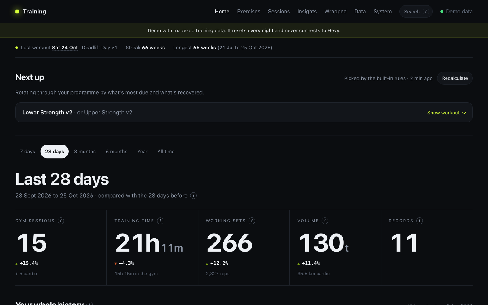
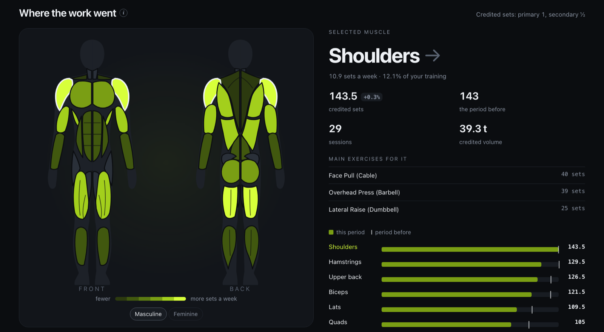
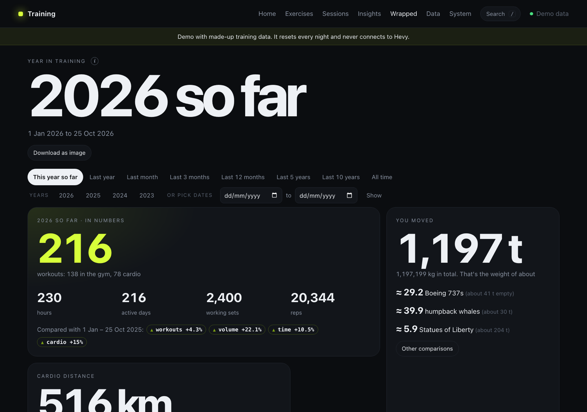
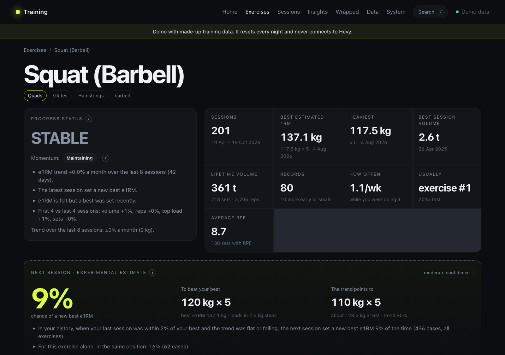
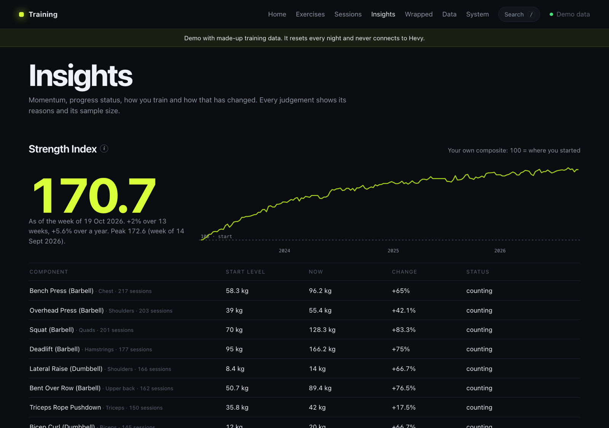

# Hevy Analytics

Self-hosted training analytics for your [Hevy](https://www.hevyapp.com/) workout history: progress, plateaus, muscle
balance, records, a yearly Wrapped, data exports and a suggested next workout from your own programme. It keeps a
private copy of your history on your own machine and never writes to Hevy.

**Live demo** with three and a half years of made-up training (resets every night): <https://mubar.uk/hevy/>



Not affiliated with Hevy. It uses Hevy's official API, which needs a Hevy Pro subscription.

## What it does

- **Homepage**: any period (7 days to all time, or drag across your whole history) compared with the one before:
  sessions, time, working sets, volume and records, strength changes per exercise, a calendar and a muscle map.
- **Muscle map**: front and back, coloured by credited sets a week, masculine or feminine, and drawn broader or slimmer
  from your BMI if you add your height.
- **Exercises**: estimated 1RM over time, plateaus and momentum, records of every kind, and the chance of a new best
  next session (an empirical estimate, backtested on your own history, with its calibration shown).
- **Insights**: a chain-linked Strength Index, Training DNA, muscle balance, and whether exercise order affects
  your lifts.
- **Wrapped**: a year (or any period) in training, with fun scaled comparisons ("you lifted 5.9 Statues of
  Liberty"), downloadable as an image.
- **Next workout**: the next one or two workouts from your own Hevy routines, with targets for every set (see below).
- **Data**: an explorer for every set, and exports to CSV, JSON and Excel.
- **Sessions**: every workout, and side-by-side comparisons of two.

| | |
|---|---|
|  |  |
|  |  |

Every calculation is explained in the app (the ⓘ buttons) and in [docs/METRICS.md](docs/METRICS.md).

## Try it with made-up data

Python 3.11 or newer.

```bash
python3 -m venv .venv && .venv/bin/pip install -r requirements-dev.txt
HEVY_ENV=development HEVY_DATA_DIR=var-dev .venv/bin/python -m hevy.cli demo-seed
scripts/dev.sh
```

Open <http://127.0.0.1:8778/hevy/>. In development mode the site answers only to this computer.

## Use it with your own Hevy history

1. With Hevy Pro, copy your API key from <https://hevy.com/settings?developer> and save it in a file only you can read, for example
   `~/.config/hevy-analytics/api-key`.
2. Start the sync worker. It downloads your history, then checks for changes every 10 minutes:
   ```bash
   HEVY_ENV=development HEVY_DATA_DIR=var-dev HEVY_API_KEY_FILE=~/.config/hevy-analytics/api-key \
     .venv/bin/python -m hevy.worker
   ```
   Use an empty `var-dev` folder (or another `HEVY_DATA_DIR`): the app never mixes demo data with real data.
3. Run `scripts/dev.sh` as above.

To run it on a server with a login in front, as two hardened services, see
[docs/SELF-HOSTING.md](docs/SELF-HOSTING.md).

## Next workout suggestions

Pick your programme (a set of Hevy routines) on the System page. The homepage then suggests what to do next, with
targets for each exercise. You can choose where the suggestion comes from:

| | Cost | How |
|---|---|---|
| **Built-in rules** | Free | Always on. Rotates through your programme by how often you usually do each routine, skips muscles trained in the last 48 hours, and sets double-progression targets that ease back after time off. |
| **Your own GPT in ChatGPT** | Included in a paid ChatGPT plan | Ask your GPT "what's my next workout?". It reads your training from your site, answers in the chat, and posts the same pick to your homepage. No API billing; nothing runs until you ask. See [docs/CHATGPT.md](docs/CHATGPT.md). |
| **OpenAI API key** | Pay as you go (a few pence a suggestion) | The sync worker asks OpenAI after each new workout, or when you press Recalculate, up to a daily limit. See [docs/SELF-HOSTING.md](docs/SELF-HOSTING.md#next-workout-from-the-openai-api). |

Whichever you use, a suggestion has to fit your programme and plausible loads before it is shown; otherwise the
built-in rules' answer is shown, with the reason.

A ChatGPT plan can also be used through OpenAI's Codex command-line tool, which can sign in with your ChatGPT account.
That route is not built in: it would mean running Codex on your server for each suggestion, which is outside what
Codex is meant for.

## Privacy and safety

- Your data stays in one SQLite file on your machine. Every version Hevy sends is kept (append-only), and everything
  else is rebuilt from it.
- In production, the web app has no network access at all. Only the sync worker talks to Hevy, and to OpenAI if
  you enable the API option. Keys are read from files, never from settings or the environment.
- The ChatGPT route opens two addresses to ChatGPT's servers, locked by a key of which only a hash is stored.

## Development

```bash
.venv/bin/python -m pytest -q
```

The front end is plain ES modules and CSS with no build step (`hevy/static/`). The back end is FastAPI and SQLite
(`hevy/`). [docs/METRICS.md](docs/METRICS.md) is the reference for every number the app shows.

## Licence

MIT. See [LICENSE](LICENSE).
